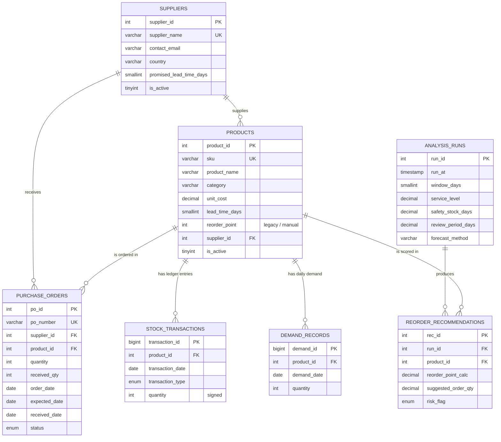

# D2 — Database Design

MySQL 8.0+ / MariaDB 10.6+, InnoDB, `utf8mb4`. Script: [`sql/schema.sql`](../sql/schema.sql).
Sample data: [`sql/seed_data.sql`](../sql/seed_data.sql) (generated by
`scripts/generate_seed_data.py`).

---

## 1. Entity–relationship model



ASCII sketch (for the printed report):

```
suppliers 1 ──< products 1 ──< purchase_orders
                     │  1 ──< stock_transactions
                     │  1 ──< demand_records
                     │  1 ──< reorder_recommendations >── 1 analysis_runs
```

---

## 2. Table-by-table design

### 2.1 `suppliers`

| Column | Type | Constraints | Why |
|---|---|---|---|
| `supplier_id` | INT UNSIGNED | PK, AUTO_INCREMENT | surrogate key |
| `supplier_name` | VARCHAR(120) | NOT NULL, UNIQUE | business key; prevents duplicate vendors |
| `contact_email` | VARCHAR(160) | NULL, CHECK contains `@` and `.` | validation at the storage layer too |
| `country` | VARCHAR(60) | NOT NULL DEFAULT 'India' | supplier concentration analysis |
| `promised_lead_time_days` | SMALLINT UNSIGNED | NOT NULL, CHECK 1–180 | contractual lead time, compared with observed |
| `is_active` | TINYINT(1) | NOT NULL DEFAULT 1 | soft retire without breaking history |
| `created_at`, `updated_at` | TIMESTAMP | defaults / ON UPDATE | audit |

### 2.2 `products`

| Column | Type | Constraints | Why |
|---|---|---|---|
| `product_id` | INT UNSIGNED | PK | surrogate key |
| `sku` | VARCHAR(32) | NOT NULL, UNIQUE | the code planners actually use |
| `product_name` | VARCHAR(150) | NOT NULL | display |
| `category` | VARCHAR(60) | NOT NULL, indexed | category-level reporting |
| `unit_cost` | DECIMAL(12,2) | NOT NULL, CHECK > 0 | money → DECIMAL, never FLOAT |
| `lead_time_days` | SMALLINT UNSIGNED | NOT NULL, CHECK 1–180 | planned lead time (fallback when there are too few deliveries to observe) |
| `reorder_point` | INT UNSIGNED | NOT NULL DEFAULT 0 | **manually maintained** ROP. The analytics layer computes its own value and reports the gap (`gap_vs_master_rop`) instead of overwriting it — this keeps the "before/after" story auditable |
| `supplier_id` | INT UNSIGNED | NOT NULL, FK → `suppliers` RESTRICT | one supplier per SKU (assumption A1) |
| `is_active` | TINYINT(1) | NOT NULL DEFAULT 1 | retire SKUs with history |

### 2.3 `purchase_orders`

Single-line POs (assumption A3). If a supplier sends one delivery for several
products, there are several PO rows.

| Column | Type | Constraints | Why |
|---|---|---|---|
| `po_id` | INT UNSIGNED | PK | |
| `po_number` | VARCHAR(24) | NOT NULL, UNIQUE | human reference used in the ledger |
| `supplier_id`, `product_id` | INT UNSIGNED | NOT NULL, FK RESTRICT | referential integrity |
| `quantity` | INT UNSIGNED | NOT NULL, CHECK > 0 | |
| `received_qty` | INT UNSIGNED | NULL, CHECK ≤ `quantity` | partial receipts |
| `order_date` | DATE | NOT NULL | lead-time start |
| `expected_date` | DATE | NOT NULL, CHECK ≥ `order_date` | promise used for on-time measurement |
| `received_date` | DATE | NULL, CHECK ≥ `order_date` | lead-time end |
| `status` | ENUM | OPEN / PARTIAL / RECEIVED / CANCELLED | validated against `received_date`/`received_qty` in the API |
| `notes` | VARCHAR(255) | NULL | e.g. "Supplier confirmed delay" |

Indexes: `idx_po_supplier`, `idx_po_product`, `idx_po_status_dates (status, order_date, received_date)` —
the last one serves the supplier KPI queries and the "overdue open orders" filter.

### 2.4 `stock_transactions` (perpetual ledger)

| Column | Type | Constraints | Why |
|---|---|---|---|
| `transaction_id` | BIGINT UNSIGNED | PK | high volume |
| `product_id` | INT UNSIGNED | NOT NULL, FK RESTRICT | |
| `transaction_date` | DATE | NOT NULL, `idx_st_product_date` | balance as of any date |
| `transaction_type` | ENUM | RECEIPT / ISSUE / ADJUSTMENT / RETURN | |
| `quantity` | INT (**signed**) | NOT NULL, CHECK ≠ 0 | positive = stock in, negative = stock out |
| `reference`, `notes` | VARCHAR | NULL | traceability to the PO or cycle count |

`on_hand` is **never stored**: it is `SUM(quantity)` per product, so it is always
reconcilable with the movement history (assumption A4). The API refuses a movement
that would push the balance below zero.

### 2.5 `demand_records`

| Column | Type | Constraints | Why |
|---|---|---|---|
| `demand_id` | BIGINT UNSIGNED | PK | |
| `product_id` | INT UNSIGNED | NOT NULL, FK RESTRICT | |
| `demand_date` | DATE | NOT NULL | |
| `quantity` | INT UNSIGNED | NOT NULL (≥ 0 by type) | units demanded that day |

`UNIQUE (product_id, demand_date)` — one row per product per day; the API uses
`INSERT ... ON DUPLICATE KEY UPDATE` so re-uploads are idempotent.
`idx_demand_date` supports portfolio-wide date filters.

### 2.6 `analysis_runs` + `reorder_recommendations` (audit trail)

Every explicit analysis run (`POST /api/analytics/run`) stores the parameter set and
the resulting recommendation snapshot. This is how the project answers "why did the
system suggest 300 units?" six weeks later — without ever writing to
`purchase_orders`.

---

## 3. Views

| View | Purpose |
|---|---|
| `v_product_inventory` | product master + `on_hand` from the ledger (single join, reusable by BI tools) |
| `v_po_delivery` | PO + supplier + `actual_lead_time_days` and `delay_days` (DATEDIFF), used for supplier KPIs |

---

## 4. Integrity rules (where each rule lives)

| Rule | Enforced by |
|---|---|
| A PO cannot reference a nonexistent product/supplier | FK + API pre-check with a readable 409 |
| `expected_date ≥ order_date` | CHECK constraint **and** validator (422 with field detail) |
| `received_qty ≤ quantity` | CHECK + validator |
| RECEIVED ⇒ `received_date` present; OPEN/CANCELLED ⇒ no `received_date` | validator (business rule, not expressible as a simple CHECK) |
| ISSUE must be negative, RECEIPT/RETURN positive | validator + CHECK `quantity <> 0` |
| Stock balance never negative | API transaction check (409) |
| One demand row per product per day | UNIQUE + upsert |
| SKU/PO number/supplier name unique | UNIQUE indexes → 409 `DUPLICATE_RECORD` |
| History is never destroyed | DELETE endpoints return 409 `RECORD_IN_USE` when children exist; `is_active` retires instead |

---

## 5. Data dictionary (column-level, generated from the live schema)

The authoritative and always-current version of this section is produced by:

```bash
python scripts/dump_data_dictionary.py        # writes docs/data_dictionary.md
```

Summary of the current schema (24 columns of interest across 6 tables):

| Table | Rows (sample data) | Key columns |
|---|---|---|
| `suppliers` | 6 | `supplier_id` PK, `supplier_name` UK |
| `products` | 24 | `product_id` PK, `sku` UK, `supplier_id` FK |
| `purchase_orders` | 377 | `po_id` PK, `po_number` UK, 2 FKs |
| `stock_transactions` | 11 359 | `transaction_id` PK, `product_id` FK |
| `demand_records` | 12 411 | `demand_id` PK, (`product_id`,`demand_date`) UK |
| `analysis_runs` | 1 per run | `run_id` PK |
| `reorder_recommendations` | 24 per run | PK, FKs to run + product, (`run_id`,`product_id`) UK |

---

## 6. Sample data (excerpt)

```sql
-- suppliers
INSERT INTO suppliers (supplier_id, supplier_name, contact_email, country,
                       promised_lead_time_days, is_active) VALUES
  (1, 'Precision Auto Components Pvt Ltd', 'orders@precisionauto.example.com', 'India', 10, 1),
  (5, 'Krishna Plastics & Packaging', 'hello@krishnaplastics.example.com', 'India', 12, 1);

-- products (reorder_point is the legacy manual value)
INSERT INTO products (product_id, sku, product_name, category, unit_cost,
                      lead_time_days, reorder_point, supplier_id, is_active) VALUES
  (1, 'AUTO-BRK-0012', 'Brake Caliper Assembly 12in', 'Braking', 2450.00, 10, 156, 1, 1),
  (22,'ELEC-MOD-1150', 'Telematics Module LTE',       'Electronics', 6200.00, 25, 88, 2, 1);

-- purchase orders (OPEN, PARTIAL and RECEIVED states all occur)
INSERT INTO purchase_orders (po_number, supplier_id, product_id, quantity, received_qty,
                             order_date, expected_date, received_date, status, notes) VALUES
  ('PO-001-0001', 1, 1, 195, 195, '2025-05-10', '2025-05-20', '2025-05-18', 'RECEIVED', NULL),
  ('PO-022-0010', 2, 22, 75,  51, '2026-02-13', '2026-03-06', '2026-03-06', 'PARTIAL',  'Part split delivery'),
  ('PO-018-S001', 4, 18, 220, NULL,'2026-09-17', '2026-10-17', NULL,        'OPEN',    'Supplier confirmed delay - no dispatch yet');

-- stock ledger: signed quantities
INSERT INTO stock_transactions (product_id, transaction_date, transaction_type, quantity,
                                reference, notes) VALUES
  (1, '2025-04-23', 'RECEIPT', 195, 'OPENING',     'Opening balance load'),
  (1, '2025-04-28', 'ISSUE',   -1,  'SALES',       'Customer dispatch'),
  (1, '2026-09-11', 'ADJUSTMENT', -3,'CYCLE-COUNT', 'Shrinkage / cycle count');

-- demand: one row per product per day (missing row = zero demand)
INSERT INTO demand_records (product_id, demand_date, quantity) VALUES
  (1, '2026-10-19', 10), (1, '2026-10-18', 6), (1, '2026-10-17', 3);
```

The committed seed file contains the full 12k+ row dataset. Regenerate with:

```bash
python scripts/generate_seed_data.py --end 2026-10-19 --seed 20261021
```

---

## 7. Design decisions and alternatives considered

| Decision | Chosen | Alternative rejected | Why |
|---|---|---|---|
| On-hand storage | Derived from ledger | Stored `products.on_hand` | a stored balance drifts from history; the ledger is auditable |
| PO structure | One product per PO | `purchase_order_lines` child table | the brief's schema is single-line; a header/lines split is unnecessary complexity for single-line orders (documented limitation) |
| Demand granularity | One row per product per day | weekly/monthly aggregates | daily data supports zero-fill, weekday seasonality and honest std-dev |
| ABC class | Demand **value** (units × cost) | demand units | value is the usual basis for counting effort |
| Reorder point | Computed and reported next to the manual value | overwriting `products.reorder_point` | keeps the "before/after" comparison visible and reversible |
| Money | `DECIMAL` in MySQL, float only at JSON/plot boundaries | `FLOAT` | avoids rounding drift in costs |
| Analysis parameters | `.env` defaults + per-request overrides | hard-coded constants | reviewers can re-run with other assumptions without code changes |
