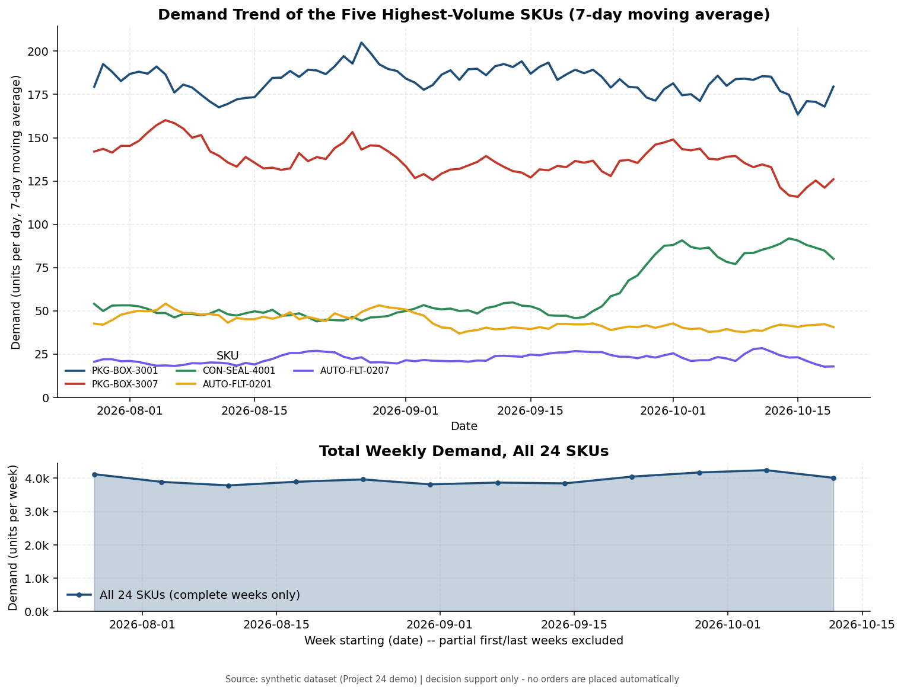
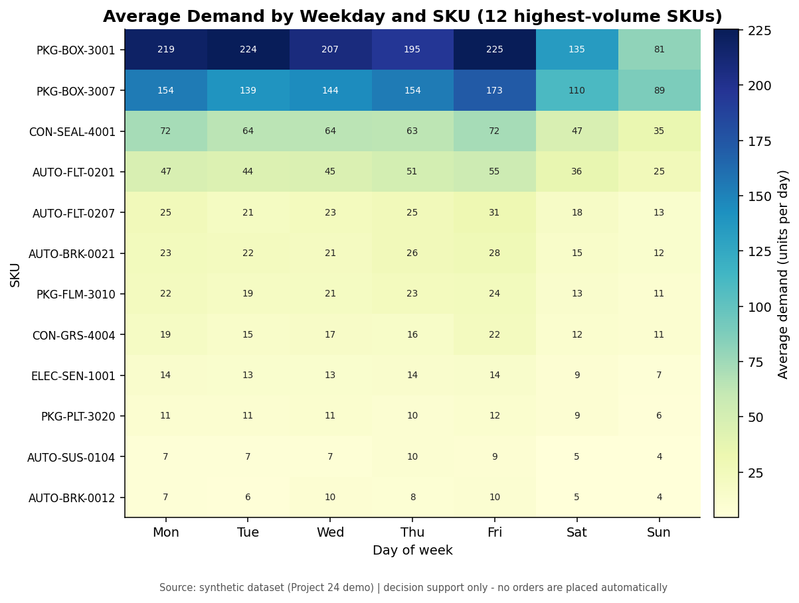
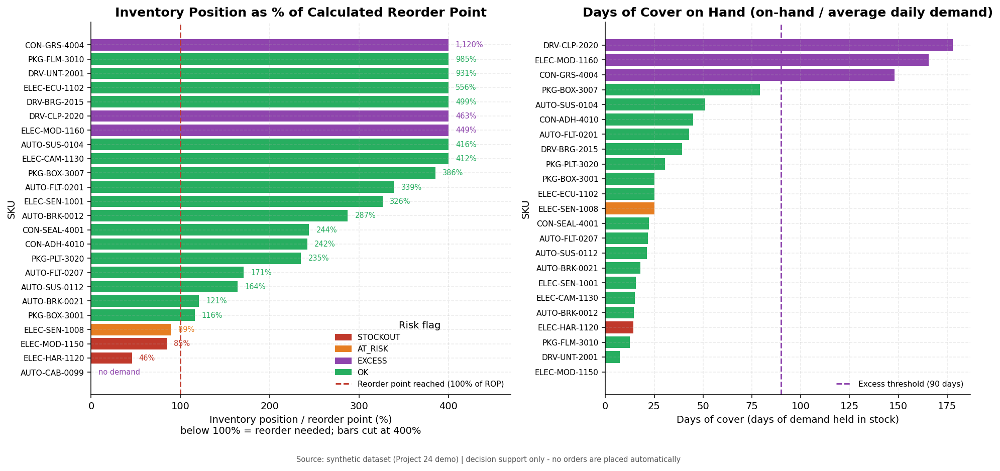
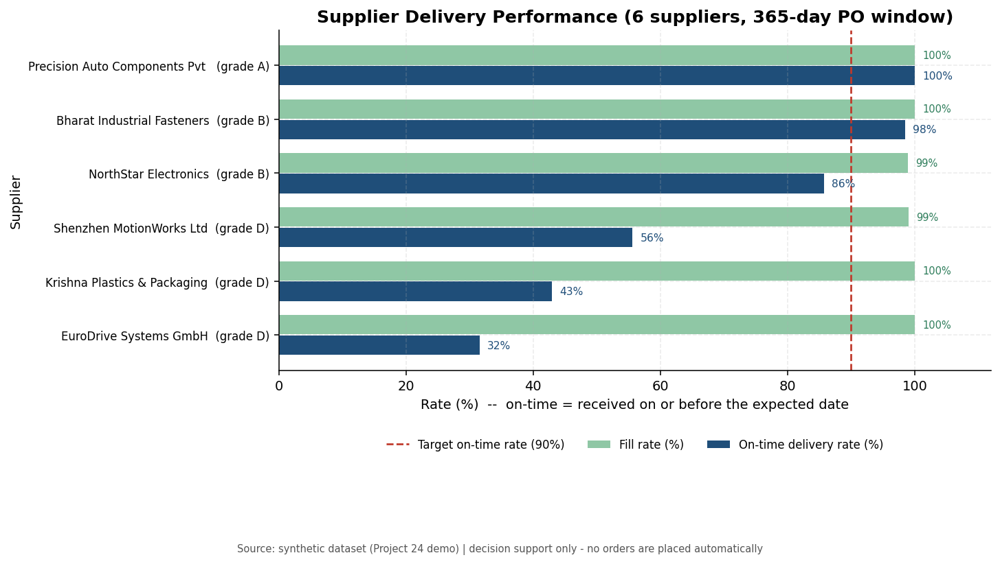
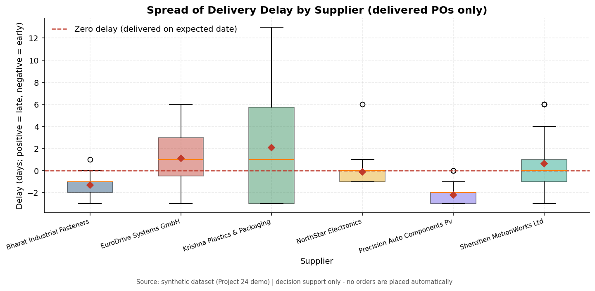
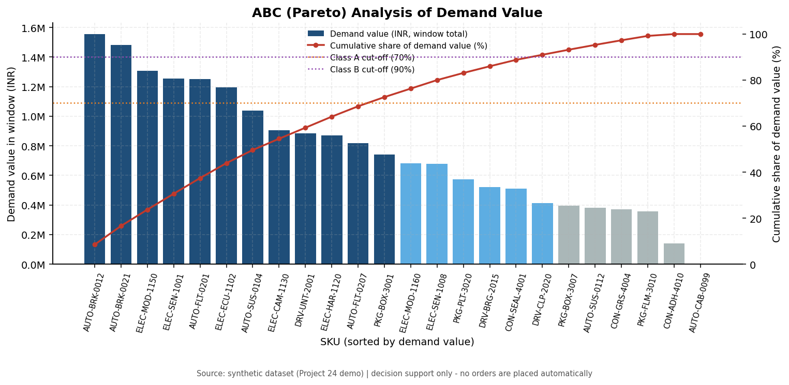
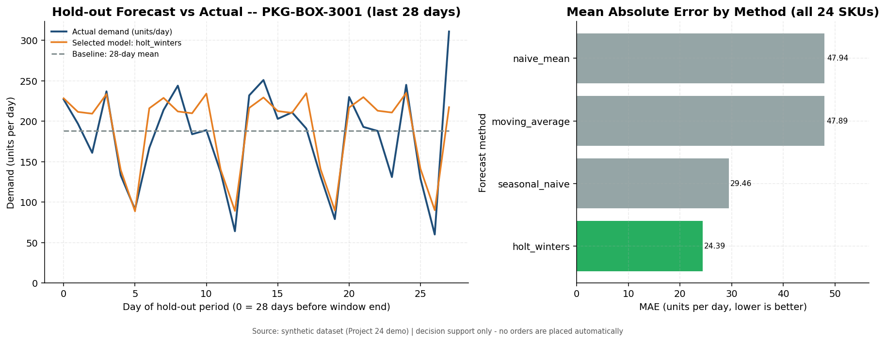
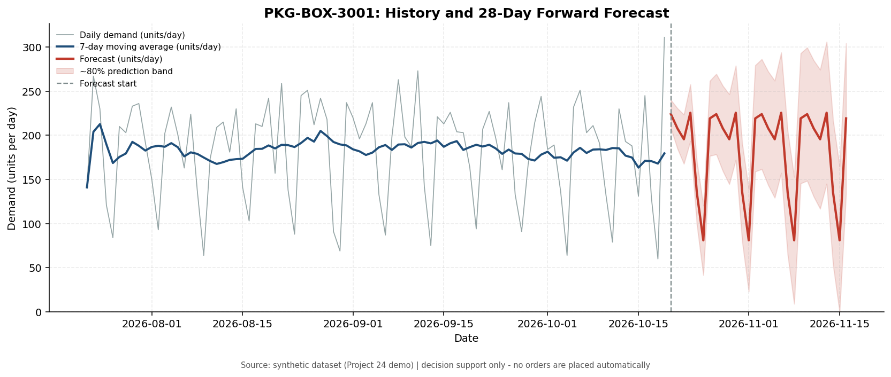
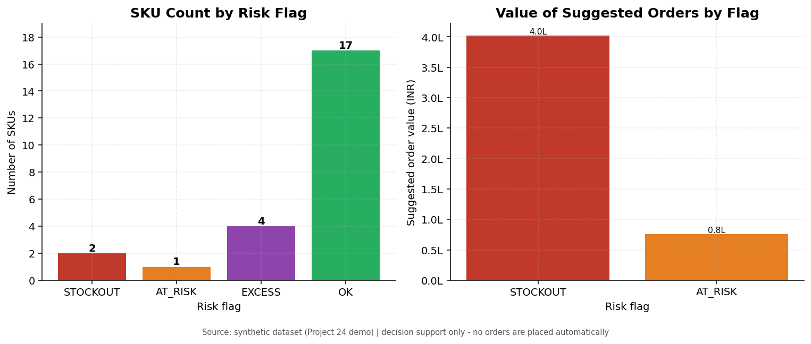
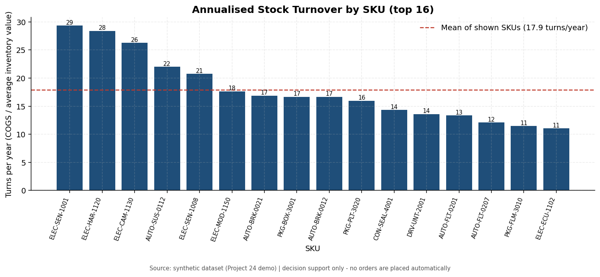

# Supply Chain Optimization and Inventory Forecasting System

### Automated analysis report

*Generated on 21 October 2026 · data as of 19 October 2026 · demo/synthetic dataset*

> **Decision support only.** Every recommendation below is a calculation for a human planner to review. The system never creates, approves or sends a purchase order.


## 1. Executive summary

- **Portfolio:** 24 SKUs across 6 suppliers; inventory on hand worth INR 7,151,593.
- **Shortage risk:** 2 SKU(s) at stockout risk and 1 below the calculated reorder point; reviewing them now would require INR 477,900 of purchases (suggestion only).
- **Excess risk:** 4 SKU(s) hold more than 90 days of cover.
- **Forecasting:** the selected models average 6.06 units/day error versus 7.90 for the naive baseline, beating the baseline on 13 of 24 SKUs.
- **Suppliers:** lowest on-time rate 31.6%, highest 100.0%.

## 2. Data and method

| Item | Value |
|---|---|
| Demand window | 2026-07-22 to 2026-10-19 (90 days) |
| Supplier PO window | 2025-10-20 to 2026-10-19 (365 days) |
| Target cycle service level | 0.950 (z = 1.6449) |
| Safety-stock policy | `max` (days policy value: 7.0 days) |
| Review period | 7.0 days |
| Excess cover threshold | 90 days of cover |
| Forecast horizon | 28 days |
| Hold-out period for scoring | 28 days |


**Formulas (units in brackets):**

```text
average daily demand  mu_d     = total demand / calendar days in window      [units/day]
demand variability    sigma_d  = sample std dev of daily demand (0-filled)   [units/day]
lead time             L        = mean observed PO lead time if >= 3 deliveries,
                                 else products.lead_time_days                  [days]
safety stock (z)      SS_z     = z(service level) * sigma_d * sqrt(L)          [units]
safety stock (days)   SS_d     = safety_stock_days * mu_d                      [units]
safety stock used     SS       = max(SS_z, SS_d)   [policy = max, default]     [units]
reorder point         ROP      = mu_d * L + SS                                [units]
inventory position    IP       = on_hand + open PO quantity                   [units]
order-up-to level     T        = ROP + mu_d * review_period_days              [units]
suggested order qty   Q        = max(0, T - IP)                               [units]
days of cover         DoC      = on_hand / mu_d                               [days]
stock turnover        TO       = (units issued * unit_cost) / average stock value [turns]
supplier score        Score    = 100 * (0.6*on_time_rate + 0.4*max(0,1-CV))   [0-100]
MASE                           = MAE(model) / MAE(naive in-sample)            [ratio]
```


## 3. Reorder recommendations, shortage and excess flags

Classification: **STOCKOUT** = out of stock or inventory position below lead-time demand; **AT_RISK** = position below ROP but lead-time demand covered; **EXCESS** = above ROP with more than 90 days of cover; **OK** otherwise.

| SKU | Product | Supplier | Avg demand (units/day) | Lead time (days) | Safety stock (units) | ROP calc (units) | ROP master (units) | On hand (units) | On order (units) | Position (units) | Cover (days) | Flag | Suggested qty (units) | Value (INR) |
|---|---|---|---|---|---|---|---|---|---|---|---|---|---|---|
| ELEC-HAR-1120 | Wiring Harness 24V | NorthStar Electronics | 2.84 | 24.60 | 19.91 | 89.87 | 86 | 41.00 | 0.00 | 41.00 | 14.42 | STOCKOUT | 69.00 | 234,600.00 |
| ELEC-MOD-1150 | Telematics Module LTE | Shenzhen MotionWorks Ltd | 2.34 | 22.20 | 16.41 | 68.44 | 88 | 0.00 | 58.00 | 58.00 | 0.00 | STOCKOUT | 27.00 | 167,400.00 |
| ELEC-SEN-1008 | Oxygen Sensor Universal | Shenzhen MotionWorks Ltd | 4.56 | 21.00 | 31.89 | 127.57 | 175 | 114.00 | 0.00 | 114.00 | 25.02 | AT_RISK | 46.00 | 75,900.00 |
| DRV-CLP-2020 | Clutch Plate 240mm | EuroDrive Systems GmbH | 1.48 | 30.00 | 12.47 | 56.81 | 106 | 263.00 | 0.00 | 263.00 | 177.94 | EXCESS | 0.00 | 0.00 |
| CON-GRS-4004 | Lithium Grease Cartridge | Bharat Industrial Fasteners | 15.89 | 6.20 | 111.22 | 209.74 | 399 | 2,350.00 | 0.00 | 2,350.00 | 147.90 | EXCESS | 0.00 | 0.00 |
| AUTO-CAB-0099 | Cabin Air Filter (Discontinued) | Bharat Industrial Fasteners | 0.00 | 6.00 | 0.00 | 0.00 | 118 | 449.00 | 0.00 | 449.00 | n/a | EXCESS | 0.00 | 0.00 |
| ELEC-MOD-1160 | Telematics Module 5G (new) | NorthStar Electronics | 0.90 | 25.00 | 10.68 | 33.18 | 78 | 149.00 | 0.00 | 149.00 | 165.56 | EXCESS | 0.00 | 0.00 |
| AUTO-BRK-0012 | Brake Caliper Assembly 12in | Precision Auto Components Pvt Ltd | 7.06 | 7.70 | 49.39 | 103.72 | 156 | 103.00 | 195.00 | 298.00 | 14.60 | OK | 0.00 | 0.00 |
| AUTO-BRK-0021 | Brake Pad Set (Front) | Precision Auto Components Pvt Ltd | 21.12 | 7.90 | 147.85 | 314.72 | 432 | 380.00 | 0.00 | 380.00 | 17.99 | OK | 0.00 | 0.00 |
| AUTO-SUS-0104 | Shock Absorber Rear | Bharat Industrial Fasteners | 7.11 | 5.30 | 49.78 | 87.47 | 189 | 364.00 | 0.00 | 364.00 | 51.19 | OK | 0.00 | 0.00 |
| AUTO-SUS-0112 | Coil Spring Heavy Duty | Bharat Industrial Fasteners | 4.31 | 6.00 | 30.18 | 56.04 | 94 | 92.00 | 0.00 | 92.00 | 21.34 | OK | 0.00 | 0.00 |
| AUTO-FLT-0201 | Oil Filter Premium | Bharat Industrial Fasteners | 43.46 | 5.60 | 304.19 | 547.55 | 966 | 1,857.00 | 0.00 | 1,857.00 | 42.73 | OK | 0.00 | 0.00 |
| AUTO-FLT-0207 | Air Filter Element | Bharat Industrial Fasteners | 22.18 | 5.70 | 155.25 | 281.66 | 567 | 481.00 | 0.00 | 481.00 | 21.69 | OK | 0.00 | 0.00 |
| ELEC-SEN-1001 | Crankshaft Position Sensor | Shenzhen MotionWorks Ltd | 11.81 | 21.10 | 82.68 | 331.89 | 262 | 183.00 | 900.00 | 1,083.00 | 15.49 | OK | 0.00 | 0.00 |
| ELEC-ECU-1102 | Engine Control Module v3 | Shenzhen MotionWorks Ltd | 1.36 | 22.10 | 10.71 | 40.68 | 56 | 34.00 | 192.00 | 226.00 | 25.07 | OK | 0.00 | 0.00 |
| ELEC-CAM-1130 | Rear Camera Module | NorthStar Electronics | 3.66 | 25.10 | 25.59 | 117.36 | 117 | 55.00 | 428.00 | 483.00 | 15.04 | OK | 0.00 | 0.00 |
| DRV-UNT-2001 | Drive Unit Assembly | EuroDrive Systems GmbH | 0.68 | 30.30 | 8.35 | 28.89 | 48 | 5.00 | 264.00 | 269.00 | 7.38 | OK | 0.00 | 0.00 |
| DRV-BRG-2015 | Bearing Kit Heavy Duty | EuroDrive Systems GmbH | 4.68 | 31.70 | 32.75 | 181.04 | 264 | 184.00 | 720.00 | 904.00 | 39.33 | OK | 0.00 | 0.00 |
| PKG-BOX-3001 | Corrugated Box 600x400 | Krishna Plastics & Packaging | 183.27 | 14.70 | 1,282.87 | 3,976.89 | 5460 | 4,611.00 | 0.00 | 4,611.00 | 25.16 | OK | 0.00 | 0.00 |
| PKG-BOX-3007 | Corrugated Box 400x300 | Krishna Plastics & Packaging | 137.52 | 13.50 | 962.65 | 2,819.20 | 4160 | 10,874.00 | 0.00 | 10,874.00 | 79.07 | OK | 0.00 | 0.00 |
| PKG-FLM-3010 | Stretch Wrap Roll | Krishna Plastics & Packaging | 18.91 | 13.60 | 132.38 | 389.57 | 624 | 239.00 | 3,600.00 | 3,839.00 | 12.64 | OK | 0.00 | 0.00 |
| PKG-PLT-3020 | Wooden Pallet ISPM-15 | Krishna Plastics & Packaging | 9.93 | 15.40 | 69.53 | 222.50 | 286 | 303.00 | 220.00 | 523.00 | 30.50 | OK | 0.00 | 0.00 |
| CON-SEAL-4001 | Gasket Seal Ring | Bharat Industrial Fasteners | 59.67 | 5.50 | 417.67 | 745.84 | 1218 | 1,328.00 | 492.00 | 1,820.00 | 22.26 | OK | 0.00 | 0.00 |
| CON-ADH-4010 | Structural Adhesive (lumpy) | Krishna Plastics & Packaging | 2.97 | 11.30 | 21.43 | 54.96 | 156 | 133.00 | 0.00 | 133.00 | 44.83 | OK | 0.00 | 0.00 |


*Full table: `reports/tables/reorder_recommendations.csv`*


### 3.1 Stockout risk (act first)

| SKU | Product | Avg demand (units/day) | Lead time (days) | On hand (units) | On order (units) | ROP (units) | Cover (days) | Suggested qty (units) | Value (INR) |
|---|---|---|---|---|---|---|---|---|---|
| ELEC-HAR-1120 | Wiring Harness 24V | 2.84 | 24.60 | 41.00 | 0.00 | 89.87 | 14.42 | 69.00 | 234,600.00 |
| ELEC-MOD-1150 | Telematics Module LTE | 2.34 | 22.20 | 0.00 | 58.00 | 68.44 | 0.00 | 27.00 | 167,400.00 |


### 3.2 At / below reorder point

| SKU | Avg demand (units/day) | Position (units) | ROP (units) | Suggested qty (units) | Value (INR) |
|---|---|---|---|---|---|
| ELEC-SEN-1008 | 4.56 | 114.00 | 127.57 | 46.00 | 75,900.00 |


### 3.3 Excess stock

| SKU | Product | On hand (units) | Value (INR) | Cover (days) | Flag |
|---|---|---|---|---|---|
| DRV-CLP-2020 | Clutch Plate 240mm | 263.00 | 815,300.00 | 177.94 | EXCESS |
| CON-GRS-4004 | Lithium Grease Cartridge | 2,350.00 | 611,000.00 | 147.90 | EXCESS |
| AUTO-CAB-0099 | Cabin Air Filter (Discontinued) | 449.00 | 130,210.00 | n/a | EXCESS |
| ELEC-MOD-1160 | Telematics Module 5G (new) | 149.00 | 1,251,600.00 | 165.56 | EXCESS |


## 4. Demand analysis

| SKU | Category | Avg demand (units/day) | Std dev (units/day) | CV | Total demand (units) | Last 28d avg (units/day) | Change (%) | Trend slope (units/day per day) | ABC |
|---|---|---|---|---|---|---|---|---|---|
| AUTO-BRK-0012 | Braking | 7.06 | 3.54 | 0.50 | 635 | 7.82 | 19.67 | 0.00 | A |
| AUTO-BRK-0021 | Braking | 21.12 | 10.38 | 0.49 | 1901 | 30.14 | 91.82 | 0.16 | A |
| AUTO-SUS-0104 | Suspension | 7.11 | 3.21 | 0.45 | 640 | 7.29 | 14.61 | -0.01 | A |
| AUTO-SUS-0112 | Suspension | 4.31 | 2.42 | 0.56 | 388 | 3.68 | -14.88 | -0.02 | C |
| AUTO-FLT-0201 | Filtration | 43.46 | 12.67 | 0.29 | 3911 | 40.14 | -5.78 | -0.11 | A |
| AUTO-FLT-0207 | Filtration | 22.18 | 8.05 | 0.36 | 1996 | 22.39 | -0.95 | 0.04 | A |
| ELEC-SEN-1001 | Electronics | 11.81 | 6.25 | 0.53 | 1063 | 17.39 | 70.28 | 0.14 | A |
| ELEC-SEN-1008 | Electronics | 4.56 | 2.54 | 0.56 | 410 | 4.86 | 13.33 | 0.00 | B |
| ELEC-ECU-1102 | Electronics | 1.36 | 1.39 | 1.02 | 122 | 1.11 | -6.06 | -0.01 | A |
| ELEC-HAR-1120 | Electronics | 2.84 | 1.98 | 0.70 | 256 | 2.46 | -16.87 | -0.01 | A |
| ELEC-CAM-1130 | Electronics | 3.66 | 2.46 | 0.67 | 329 | 3.11 | -22.32 | -0.01 | A |
| DRV-UNT-2001 | Drivetrain | 0.68 | 0.92 | 1.36 | 61 | 0.71 | 33.33 | -0.00 | A |
| DRV-BRG-2015 | Drivetrain | 4.68 | 2.53 | 0.54 | 421 | 4.79 | 1.52 | -0.01 | B |
| DRV-CLP-2020 | Drivetrain | 1.48 | 1.38 | 0.94 | 133 | 1.64 | 53.33 | -0.00 | B |
| PKG-BOX-3001 | Packaging | 183.27 | 57.76 | 0.32 | 16494 | 179.68 | -4.61 | -0.08 | A |
| PKG-BOX-3007 | Packaging | 137.52 | 33.20 | 0.24 | 12377 | 134.46 | 0.37 | -0.20 | C |
| PKG-FLM-3010 | Packaging | 18.91 | 8.67 | 0.46 | 1702 | 18.25 | 1.79 | -0.05 | C |
| PKG-PLT-3020 | Packaging | 9.93 | 3.88 | 0.39 | 894 | 10.14 | 7.17 | -0.01 | B |
| CON-SEAL-4001 | Consumables | 59.67 | 23.50 | 0.39 | 5370 | 82.50 | 66.43 | 0.47 | B |
| CON-GRS-4004 | Consumables | 15.89 | 6.32 | 0.40 | 1430 | 14.64 | -12.77 | -0.03 | C |
| AUTO-CAB-0099 | Filtration | 0.00 | 0.00 | n/a | 0 | 0.00 | n/a | 0.00 | C |
| ELEC-MOD-1150 | Electronics | 2.34 | 2.00 | 0.85 | 211 | 2.43 | 13.33 | -0.00 | A |
| ELEC-MOD-1160 | Electronics | 0.90 | 1.30 | 1.44 | 81 | 1.75 | 53.13 | 0.03 | B |
| CON-ADH-4010 | Consumables | 2.97 | 3.88 | 1.31 | 267 | 2.93 | 3.80 | -0.00 | C |


## 5. Supplier delivery performance

| Supplier | POs | Delivered | Open | On-time rate | Fill rate | Avg lead time (days) | Lead-time CV | Avg delay (days) | Score (0-100) | Grade |
|---|---|---|---|---|---|---|---|---|---|---|
| Precision Auto Components Pvt Ltd | 27 | 26 | 1 | 1.00 | 1.00 | 7.81 | 0.12 | -2.19 | 95.19 | A |
| Bharat Industrial Fasteners | 68 | 68 | 0 | 0.98 | 1.00 | 5.69 | 0.17 | -1.31 | 92.33 | B |
| NorthStar Electronics | 33 | 28 | 6 | 0.86 | 0.99 | 24.89 | 0.06 | -0.11 | 89.23 | B |
| Shenzhen MotionWorks Ltd | 55 | 45 | 10 | 0.56 | 0.99 | 21.62 | 0.10 | 0.62 | 69.36 | D |
| EuroDrive Systems GmbH | 32 | 19 | 12 | 0.32 | 1.00 | 31.11 | 0.09 | 1.10 | 55.36 | D |
| Krishna Plastics & Packaging | 49 | 42 | 6 | 0.43 | 1.00 | 14.07 | 0.33 | 2.07 | 52.41 | D |


*Definitions: lead time = received_date - order_date; delay = received_date - expected_date (positive = late). Open orders are excluded from lead-time statistics.*


## 6. Inventory turnover

| SKU | Units issued | Opening (units) | Closing (units) | Avg stock value (INR) | Turns (period) | Days of stock | Turns (annualised) |
|---|---|---|---|---|---|---|---|
| ELEC-SEN-1001 | 905.00 | 181 | 183 | 147,591.78 | 7.24 | 12.40 | 29.34 |
| ELEC-HAR-1120 | 159.00 | 0 | 41 | 77,217.78 | 7.00 | 12.90 | 28.39 |
| ELEC-CAM-1130 | 329.00 | 7 | 55 | 139,638.89 | 6.48 | 13.90 | 26.28 |
| AUTO-SUS-0112 | 388.00 | 70 | 92 | 70,048.22 | 5.43 | 16.60 | 22.01 |
| ELEC-SEN-1008 | 336.00 | 0 | 114 | 108,295.00 | 5.12 | 17.60 | 20.76 |
| ELEC-MOD-1150 | 176.00 | 26 | 0 | 250,755.56 | 4.35 | 20.70 | 17.65 |
| AUTO-BRK-0021 | 1,901.00 | 648 | 380 | 356,330.00 | 4.16 | 21.60 | 16.88 |
| PKG-BOX-3001 | 16,494.00 | 2106 | 4611 | 180,527.50 | 4.11 | 21.90 | 16.67 |
| AUTO-BRK-0012 | 635.00 | 143 | 103 | 378,960.56 | 4.11 | 21.90 | 16.65 |
| PKG-PLT-3020 | 880.00 | 191 | 303 | 143,011.56 | 3.94 | 22.90 | 15.97 |
| CON-SEAL-4001 | 5,370.00 | 1403 | 1328 | 144,280.72 | 3.54 | 25.50 | 14.34 |
| DRV-UNT-2001 | 61.00 | 32 | 5 | 264,222.22 | 3.35 | 26.90 | 13.58 |
| AUTO-FLT-0201 | 3,911.00 | 1591 | 1857 | 380,579.56 | 3.29 | 27.40 | 13.34 |
| AUTO-FLT-0207 | 1,996.00 | 848 | 481 | 274,344.67 | 2.98 | 30.20 | 12.10 |
| PKG-FLM-3010 | 1,702.00 | 485 | 239 | 126,424.67 | 2.83 | 31.80 | 11.47 |
| ELEC-ECU-1102 | 122.00 | 8 | 34 | 439,257.78 | 2.72 | 33.10 | 11.04 |
| AUTO-SUS-0104 | 640.00 | 191 | 364 | 385,794.00 | 2.69 | 33.50 | 10.90 |
| DRV-BRG-2015 | 421.00 | 63 | 184 | 212,343.11 | 2.46 | 36.60 | 9.97 |
| CON-ADH-4010 | 267.00 | 215 | 133 | 86,996.00 | 1.60 | 56.40 | 6.47 |
| CON-GRS-4004 | 1,430.00 | 1886 | 2350 | 411,958.44 | 0.90 | 99.70 | 3.66 |
| PKG-BOX-3007 | 12,377.00 | 8981 | 10874 | 438,844.80 | 0.90 | 99.70 | 3.66 |
| DRV-CLP-2020 | 133.00 | 400 | 263 | 1,022,724.44 | 0.40 | 223.20 | 1.63 |
| ELEC-MOD-1160 | 81.00 | 231 | 149 | 1,762,786.67 | 0.39 | 233.20 | 1.57 |
| AUTO-CAB-0099 | 0.00 | 451 | 449 | 130,693.33 | 0.00 | n/a | n/a |


## 7. Demand forecasting and evaluation

Models: naive mean (baseline), seasonal naive (last week), 14-day moving average and Holt-Winters (additive trend + weekly seasonality). Each model is fitted on everything except the last 28 days and scored on those days; the baseline is kept unless another model is more than 5% better.

- Products evaluated: **24**
- Models chosen: {"naive_mean": 11, "holt_winters": 11, "moving_average": 2}
- Mean hold-out MAE — baseline: **7.900**, selected: **6.059** (mean improvement 10.5%)
- SKUs where the selected model beat the baseline: **13 / 24**

| ID | Selected method | Forecast (units/day) | Forecast total (units) | Residual std (units/day) |
|---|---|---|---|---|
| 1 | naive_mean | 7.82 | 219.00 | 4.27 |
| 2 | naive_mean | 30.14 | 844.00 | 18.36 |
| 3 | holt_winters | 7.20 | 201.55 | 2.91 |
| 4 | moving_average | 3.29 | 92.00 | 1.99 |
| 5 | holt_winters | 40.25 | 1,126.98 | 7.25 |
| 6 | holt_winters | 23.02 | 644.70 | 7.72 |
| 7 | holt_winters | 19.40 | 543.14 | 8.42 |
| 8 | holt_winters | 4.59 | 128.61 | 2.64 |
| 9 | naive_mean | 1.11 | 31.00 | 1.29 |
| 10 | naive_mean | 2.46 | 69.00 | 1.60 |
| 11 | naive_mean | 3.11 | 87.00 | 2.11 |
| 12 | naive_mean | 0.71 | 20.00 | 0.97 |
| 13 | naive_mean | 4.79 | 134.00 | 2.40 |
| 14 | naive_mean | 1.64 | 46.00 | 1.79 |
| 15 | holt_winters | 183.99 | 5,151.84 | 33.24 |
| 16 | holt_winters | 130.12 | 3,643.45 | 21.78 |
| 17 | naive_mean | 18.25 | 511.00 | 8.02 |
| 18 | holt_winters | 9.79 | 274.11 | 4.32 |
| 19 | naive_mean | 82.50 | 2,310.00 | 40.57 |
| 20 | holt_winters | 15.56 | 435.58 | 4.70 |
| 21 | naive_mean | 0.00 | 0.00 | 0.00 |
| 22 | holt_winters | 2.22 | 62.27 | 2.01 |
| 23 | moving_average | 1.93 | 54.00 | 1.38 |
| 24 | holt_winters | 2.80 | 78.37 | 3.62 |


### 7.1 Parameter sensitivity of the reorder flags

The same data scored under different assumptions. This is the clearest evidence that the flags are *threshold-driven decision support*, not fixed truth:

| Safety-stock policy | Service level | Total safety stock (units) | Total ROP (units) | STOCKOUT | AT_RISK | EXCESS | OK | Suggested order value (INR) |
|---|---|---|---|---|---|---|---|---|
| zscore | 0.90 | 881.60 | 7,781.40 | 2 | 0 | 4 | 18 | 353,400.00 |
| zscore | 0.95 | 1,131.50 | 8,031.30 | 2 | 1 | 4 | 17 | 440,050.00 |
| zscore | 0.99 | 1,600.30 | 8,500.10 | 2 | 1 | 4 | 17 | 517,050.00 |
| days | 0.95 | 3,973.80 | 10,873.60 | 2 | 1 | 4 | 17 | 477,900.00 |
| max | 0.90 | 3,977.60 | 10,877.40 | 2 | 1 | 4 | 17 | 477,900.00 |
| max | 0.95 | 3,985.80 | 10,885.60 | 2 | 1 | 4 | 17 | 477,900.00 |
| max | 0.99 | 4,024.20 | 10,923.90 | 2 | 1 | 4 | 17 | 525,300.00 |


## 8. Charts and interpretation


### 8.1 Demand Trend



**Interpretation.** Demand is shown from 22 Jul 2026 to 19 Oct 2026. The five largest SKUs (packaging boxes, seal rings, oil and air filters) carry most of the volume; their moving averages are rising across the window. The lower panel shows total weekly demand for all 24 SKUs. Because a handful of SKUs dominate, they deserve the closest review of reorder points and supplier reliability.


### 8.2 Weekday Demand



**Interpretation.** Each cell is the average daily demand for one SKU and weekday (units/day). Demand peaks mid-week and on Friday (average 56.2 units/day) and falls sharply on Sunday (24.7 units/day). This weekly pattern is why the forecast adds a weekly seasonal component; it also means weekend stock levels are not comparable with weekday levels.


### 8.3 Inventory Vs Rop



**Interpretation.** Left: inventory position (on hand + open orders) divided by the calculated reorder point. 3 of 24 SKUs sit below the 100% line, the lowest being ELEC-HAR-1120 at 46%. Right: days of cover on hand; bars beyond the 90-day line are excess stock. The two views answer different questions -- 'do I need to order now?' and 'am I holding too much?' -- and a SKU can be fine on one while flagged on the other.


### 8.4 Supplier On Time



**Interpretation.** Precision Auto Components Pvt Ltd is the most reliable supplier (100% on time, grade A), while EuroDrive Systems GmbH delivers only 32% of orders on time (grade D). A low on-time rate forces either a longer planning lead time or more safety stock, so these two suppliers need different replenishment assumptions.


### 8.5 Supplier Delay



**Interpretation.** Boxes show the median, quartiles and range of delay in days; diamonds are means. Krishna Plastics & Packaging has the widest spread (16 days between best and worst delivery), which is exactly the variability that drives the z-score safety stock term. A supplier who is late only occasionally still hurts if the delay is large.


### 8.6 Abc Pareto



**Interpretation.** 12 SKUs (class A) generate 73% of demand value, so they should be counted most often and their reorder points reviewed first. Class C SKUs are numerous but contribute little value: simpler, larger orders are acceptable there.


### 8.7 Forecast Vs Actual



**Interpretation.** Left: the last 28 days are held back, every model is fitted on the earlier data only, and the winner for PKG-BOX-3001 is 'holt_winters'. Right: average MAE across all SKUs. The selected models average 6.06 units/day error against 7.90 for the naive baseline, improving on the baseline for 13 of 24 SKUs. Where the baseline wins, the simpler method is kept on purpose.


### 8.8 Forecast Horizon



**Interpretation.** The red line is the forward forecast for PKG-BOX-3001 over the next 28 days (average 184.0 units/day) and the shaded area is an approximate 80% band built from the hold-out error. The band widens with the horizon because uncertainty grows; treat the centre line as a planning figure and the band as the range a safety buffer must cover.


### 8.9 Risk Flags



**Interpretation.** 2 SKU(s) are at critical stockout risk and 1 need reordering at the next review. The suggested orders together are worth about INR 4.8 lakh -- a suggestion for the planner, not an order. 4 SKU(s) hold more than 90 days of cover, which is working capital that could be released.


### 8.10 Stock Turnover



**Interpretation.** Turnover = units issued x unit cost divided by average inventory value for the window, annualised. Low-turn SKUs (ELEC-MOD-1160, DRV-CLP-2020, PKG-BOX-3007) hold stock for a long time and are the first candidates for order-size reductions, while high-turn SKUs need dependable suppliers because a late delivery hurts immediately.


## 9. Assumptions and limitations


1. **Synthetic data.** The dataset is simulated (see `scripts/generate_seed_data.py`);
   results demonstrate the method, not a real business.
2. **Zero-demand days.** Days with no row in `demand_records` are treated as zero
   demand, so averages use calendar days, not "days with a sale".
3. **Lead time is calendar-based** and demand is treated as independent between
   days (`sqrt(L)` scaling). Strongly correlated demand would need a different model.
4. **Observed vs master lead time.** After 3 deliveries the mean observed lead time
   replaces `products.lead_time_days`; small samples are noisy.
5. **Safety stock ignores supplier variability** (no `sigma_L` term) unless the
   z-score policy is combined with a longer lead time; a `sigma_L` extension is
   listed as future work.
6. **Order quantity is a simple order-up-to level**, not an EOQ or MOQ-constrained
   quantity.
7. **On-order quantity trusts open POs**; an open PO that will never be delivered
   (see SKU with a stalled order) overstates the inventory position.
8. **Forecasts** are simple and univariate: no promotions, price or weather inputs,
   and the evaluation uses a single hold-out period.
9. **Costs** use `unit_cost` only; holding, ordering and stockout penalty costs are
   not modelled.
10. **Timezone/date edge cases** at month ends and partial weeks are handled by
    excluding incomplete weeks from weekly totals.


## 10. Reproducing this report

```bash
python scripts/generate_seed_data.py --load   # build synthetic data
python scripts/run_pipeline.py                # tables + charts + report
python -m pytest tests -q                     # 197 automated tests
python run.py                                 # REST API on :5000
```


---
*Generated by `scripts/run_pipeline.py`. Numbers in this report are recomputed from the database on every run.*
